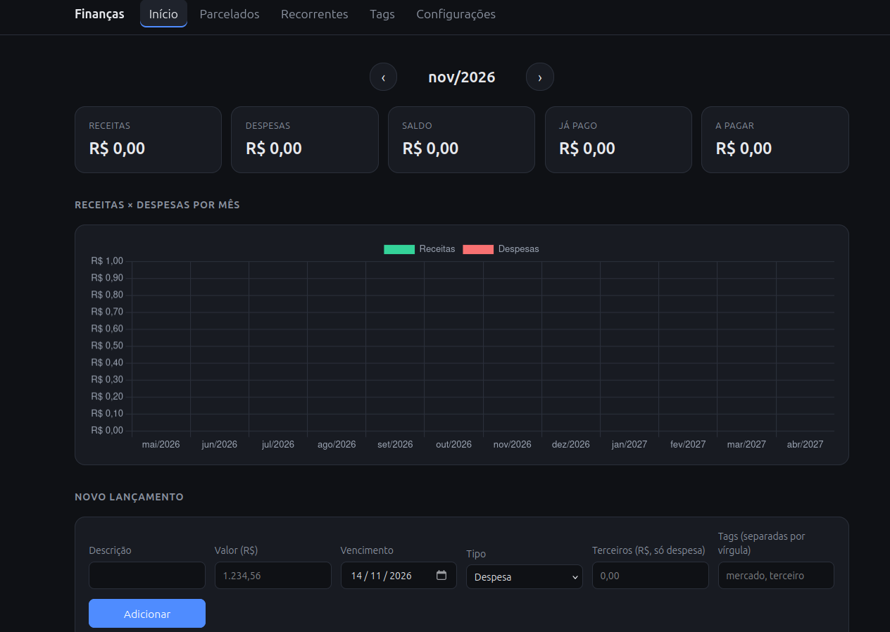
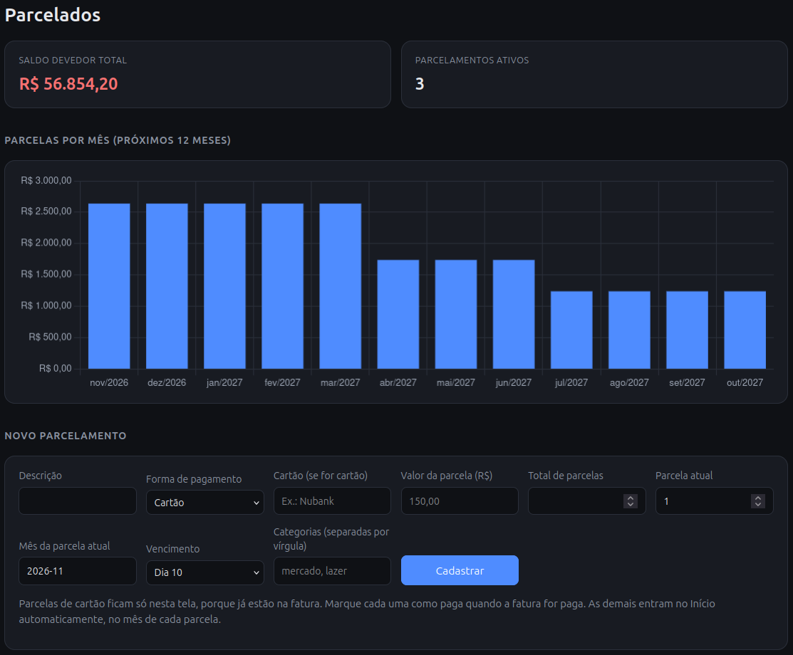

# Finanças

Controle financeiro pessoal, autohospedado, rodando como add-on do Home Assistant. Acesso pelo painel lateral do Home Assistant (ingress), sem login próprio.

## Telas

## O que faz

- Lançamentos de receitas e despesas por mês, pela data de vencimento (regime de caixa).
- Despesas com valor de terceiros: a parte que não é sua sai do total.
- Recorrentes: regras mensais que geram lançamentos nos próximos 12 meses. Podem ter valor fixo ou variável (estimativa, ajustada mês a mês).
- Parcelados: boleto, carnê, financiamento ou cartão. Parcelas de cartão ficam só na aba Parcelados.
- Tags, com filtro por mês. A tag "terceiro" não entra no total.
- Projeção dos próximos meses: compromissos cadastrados mais a média dos gastos avulsos.
- Gráficos de receitas × despesas por mês e de parcelas por mês.
- Configurações: horizonte da projeção, backup, importação e apagar dados.

## Últimas versões

- **0.0.3**: nova aba Configurações, com projeção de 1 a 12 meses, backup (baixar e importar) e apagar dados com confirmação.
- **0.0.2**: layout adaptado para celular.
- **0.0.1**: primeira versão no Home Assistant.

Histórico completo em [CHANGELOG completo](financas/CHANGELOG.md).

## Instalação no Home Assistant

1. Vá em Configurações → Apps → Loja → menu ⋮ → Repositórios.
2. Adicione o endereço deste repositório.
3. Instale o Finanças, inicie e ative "Mostrar na barra lateral".

## Rodar localmente (desenvolvimento)

Requisitos: uv e Python 3.15 (ou outra versão compatível com as dependências).

    cd financas
    uv venv --python 3.15
    uv pip install -r requirements.txt
    FINANCAS_DB=./finance-dev.db uv run uvicorn app.main:app --reload

Abra http://127.0.0.1:8000 no navegador. O banco de teste fica em finance-dev.db, separado de qualquer banco real.

## Dados

O banco SQLite fica em /data/finance.db dentro do add-on e não é versionado. Antes de atualizar ou apagar qualquer coisa, baixe um backup pela aba Configurações.

## Estrutura

- financas/config.yaml: configuração do add-on (versão, ingress, ícone).
- financas/Dockerfile: imagem do add-on.
- financas/app/main.py: rotas da aplicação.
- financas/app/services/: regras de negócio (recorrentes, parcelados, projeção, resumo e gráficos).
- financas/app/templates/: telas em Jinja2.
- financas/CHANGELOG.md: histórico de versões.
