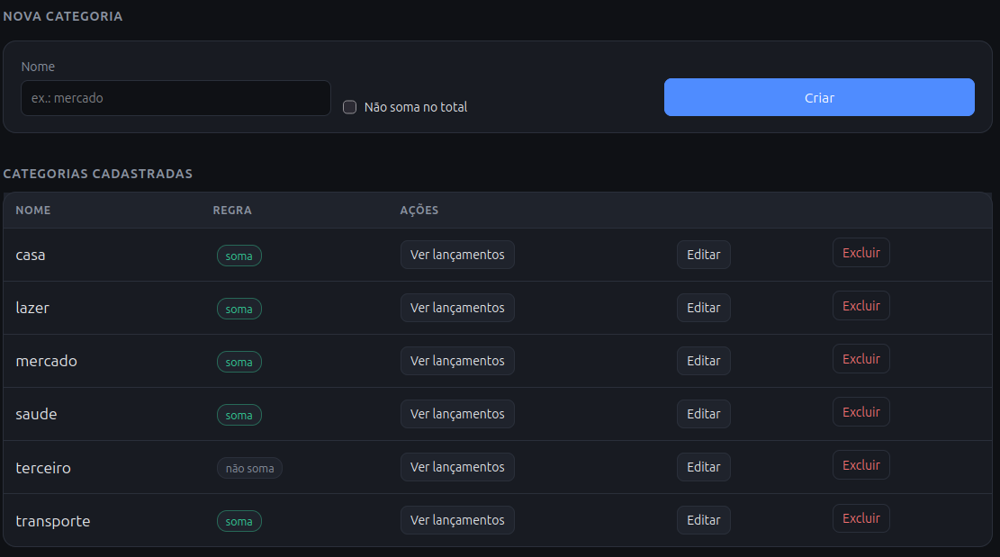
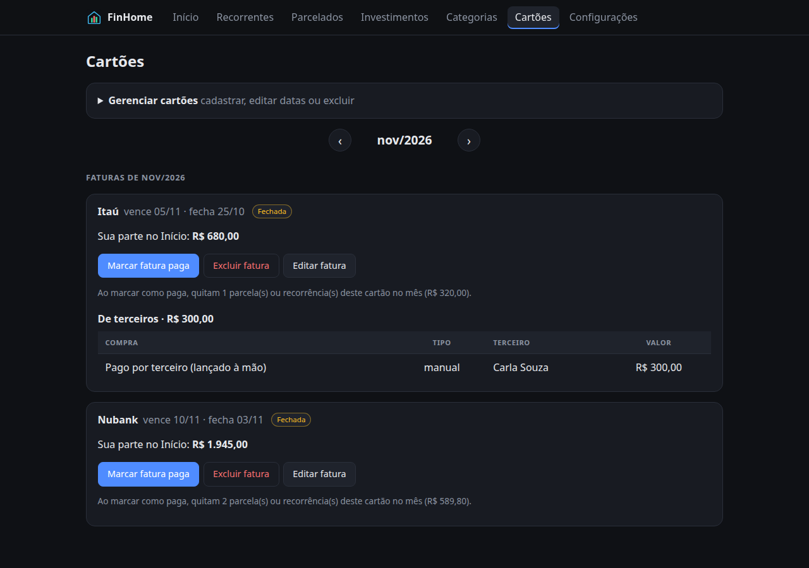
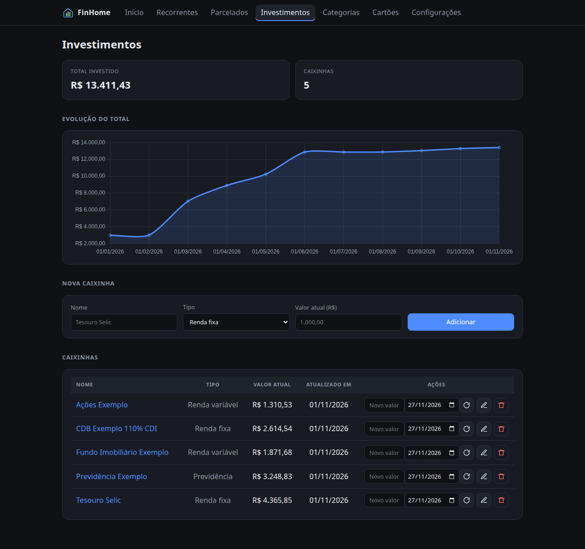
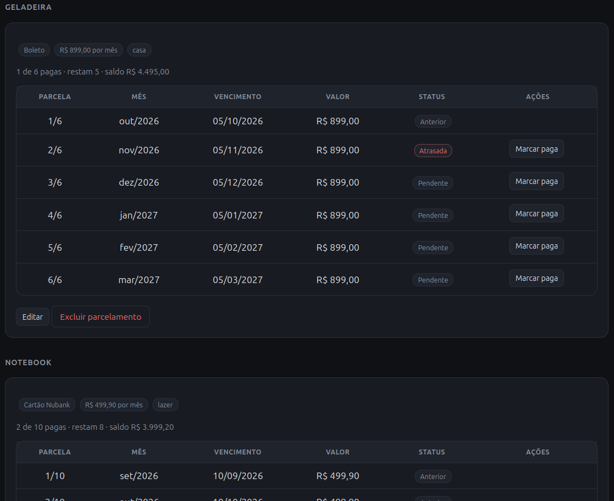
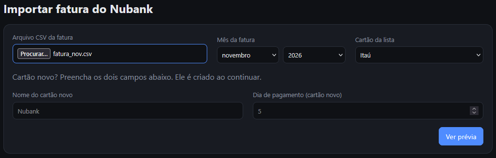
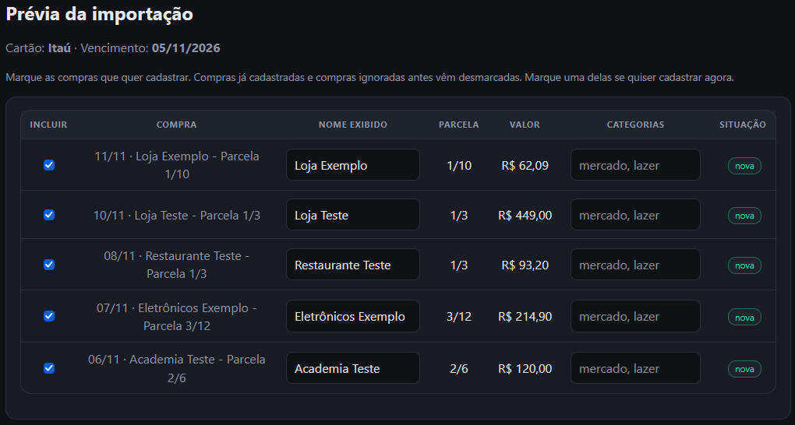
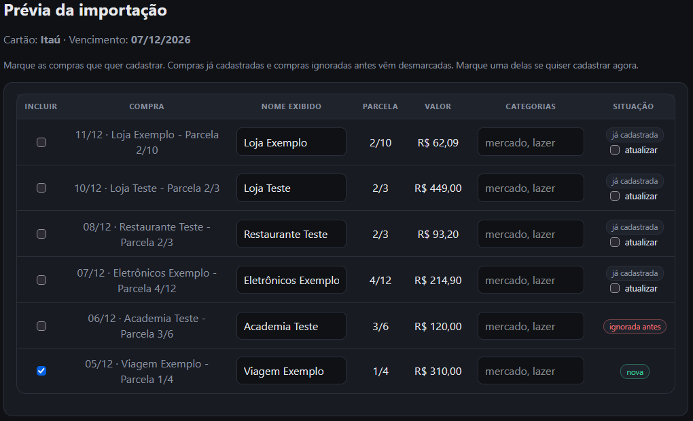
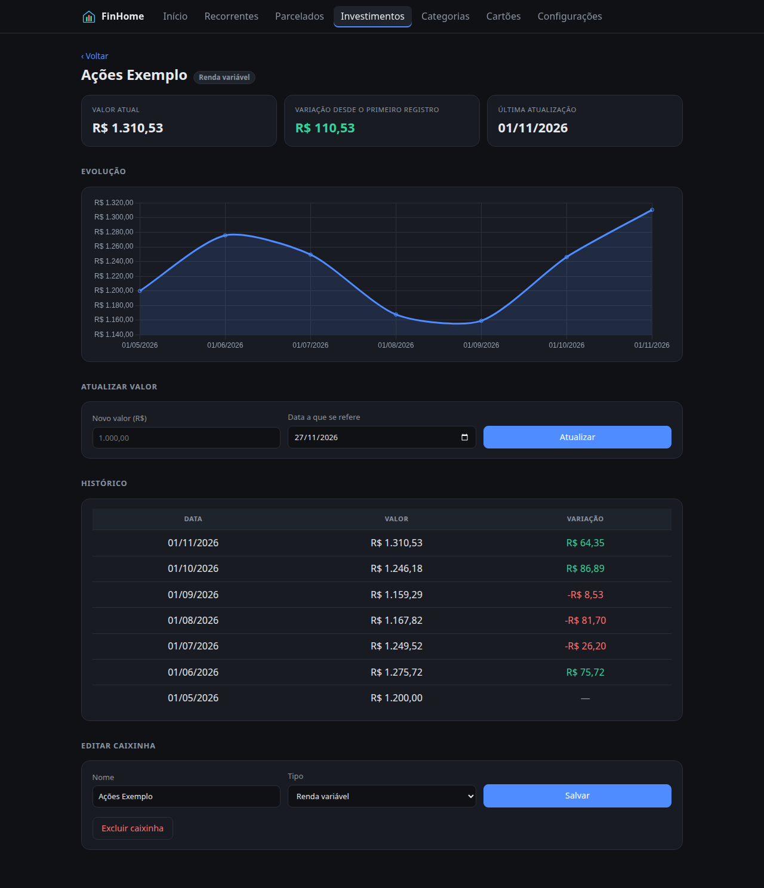
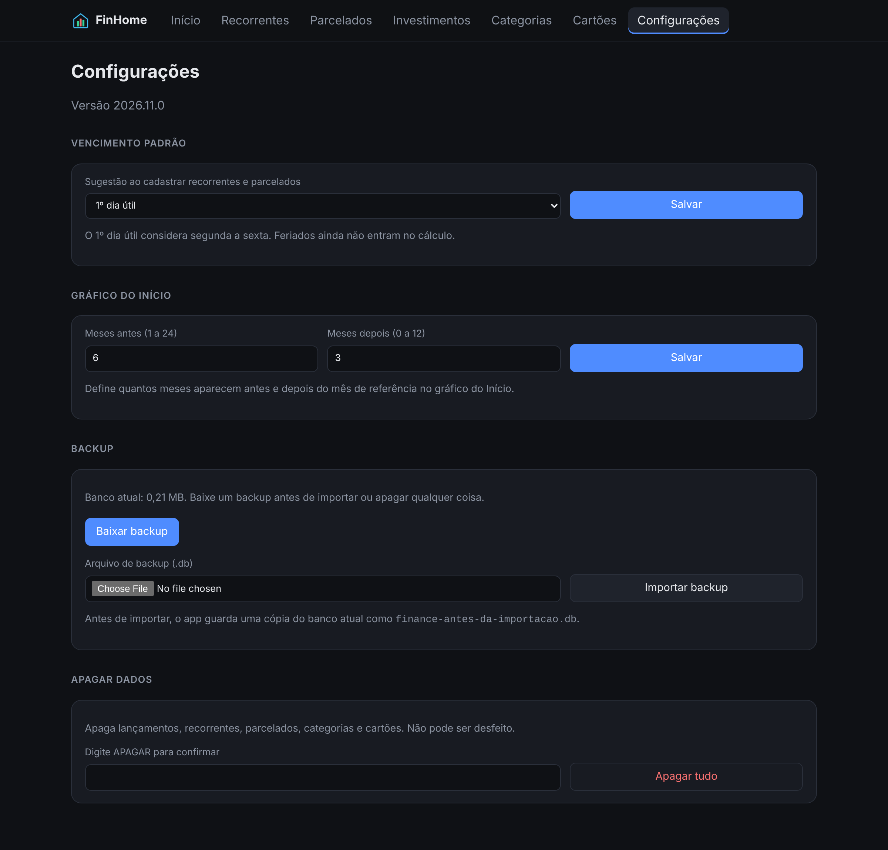

# Finanças

Controle financeiro pessoal para o Home Assistant. Roda como add-on, guarda os dados localmente em SQLite e abre pelo painel lateral do Home Assistant.

## Funcionalidades

- Receitas e despesas por mês, pela data de vencimento
- Recorrentes com valor fixo ou variável
- Parcelados de cartão, boleto, carnê ou financiamento
- Importação da fatura do Nubank (CSV), com prévia antes de gravar
- Cartões com dia de pagamento
- Categorias com relatório mensal
- Investimentos com histórico e gráfico de evolução
- Backup e importação do banco pela própria interface

## Telas

| | |
|---|---|
|  |  |
|  |  |
|  |  |

<details>
<summary>Mais capturas</summary>









</details>

## Instalação no Home Assistant

1. Em **Configurações → Apps → Loja**, abra o menu ⋮ e clique em **Repositórios**.
2. Adicione `https://github.com/raiguilhermems/ha-apps`.
3. Instale **Finanças**, inicie e ative **Mostrar na barra lateral**.

Antes de atualizar, baixe um backup em **Configurações**.

## Desenvolvimento

Requisito: [uv](https://docs.astral.sh/uv/).

```bash
cd financas
uv venv
uv pip install -r requirements.txt -r requirements-dev.txt
FINANCAS_DB=./finance-dev.db uv run uvicorn app.main:app --reload
```

A aplicação fica em http://127.0.0.1:8000.

Testes:

```bash
uv run pytest -v
```

Os testes usam um banco temporário e não tocam no banco de desenvolvimento.

### Banco de demonstração

```bash
cd financas
PYTHONPATH=. FINANCAS_DB=./demo.db uv run python scripts/seed_demo.py
PYTHONPATH=. FINANCAS_DB=./demo.db uv run python scripts/seed_investimentos.py
FINANCAS_DB=./demo.db uv run uvicorn app.main:app --port 8001
```

Os arquivos de fatura fictícia para testar a importação estão em `financas/scripts/demo/`.

## Estrutura

```
financas/
├── app/
│   ├── routers/     uma rota por tela
│   ├── services/    regras de negócio
│   └── templates/   telas (Jinja2)
├── scripts/         dados de demonstração
└── tests/           testes automatizados
```

## Dados

O banco fica em `/data/finance.db` dentro do add-on e não é criptografado. Backups podem ter até 50 MB.

## Documentação

- [Guia de uso](financas/DOCS.md)
- [Changelog](financas/CHANGELOG.md)
