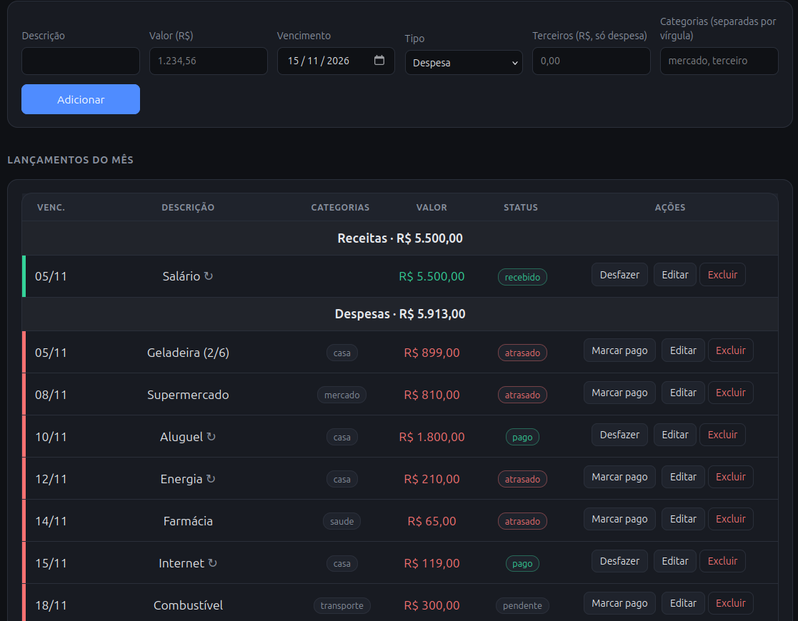

# Finanças

Controle financeiro pessoal, autohospedado, rodando como add-on do Home Assistant. Acesso pelo painel lateral do Home Assistant (ingress), sem login próprio.

## Telas

### Início

Visão do mês escolhido: totais de receitas, despesas, saldo e o que já foi pago ou ainda falta pagar. Os lançamentos aparecem com as receitas primeiro e as despesas depois, cada grupo com o seu total. Também mostra os atrasados, um gráfico de receitas × despesas e a projeção dos próximos meses.

---

### Parcelados

Todos os parcelamentos em andamento, com a forma de pagamento, o cartão (quando houver), as categorias e o saldo que ainda falta pagar. Traz um gráfico com o total de parcelas por mês e o formulário para cadastrar um novo parcelamento.

---

### Recorrentes

Regras mensais, como salário, aluguel e assinaturas. A tabela de verificação mostra, mês a mês, se cada regra já foi lançada, paga ou recebida, e avisa quando o valor real é diferente do previsto.

---

### Categorias

Lista das categorias usadas nos lançamentos. Ao abrir uma categoria, você vê os lançamentos dela no mês escolhido e um gráfico com a evolução mensal de receitas e despesas dela.

---

### Configurações

Vencimento padrão dos lançamentos, horizonte da projeção, backup e importação do banco, e a opção de apagar todos os dados.

## O que faz

- Lançamentos de receitas e despesas por mês, pela data de vencimento (regime de caixa).
- No mês, receitas aparecem primeiro, depois despesas, cada grupo com o seu total. Receitas em verde e despesas em vermelho.
- Saldo do mês em verde quando positivo e em vermelho quando negativo.
- Despesas com valor de terceiros: a parte que não é sua sai do total.
- Recorrentes: regras mensais que geram lançamentos nos próximos 12 meses. Podem ter valor fixo ou variável (estimativa, ajustada mês a mês) e categorias.
- Vencimento padrão configurável, com a opção de 1º dia útil (segunda a sexta, sem feriados).
- Parcelados: boleto, carnê, financiamento ou cartão, com categorias. Parcelas de cartão ficam só na aba Parcelados.
- Categorias, com filtro por mês, gráfico mensal de receitas e despesas e links a partir de cada lançamento. A categoria "terceiro" não entra no total.
- Projeção dos próximos meses: compromissos cadastrados mais a média dos gastos avulsos.
- Gráficos de receitas × despesas por mês e de parcelas por mês.
- Configurações: vencimento padrão, horizonte da projeção, backup, importação e apagar dados.

## Últimas versões

- **0.0.13**: início com receitas e despesas separadas e cores por tipo; categorias clicáveis no início; gráfico mensal por categoria.
- **0.0.12**: remoção do código legado de faturas e textos de categorias.
- **0.0.11**: código do app dividido em módulos por tela e testes automatizados.
- **0.0.10**: categorias e cartões em caixinhas clicáveis.
- **0.0.9**: edição de parcelamentos.

Histórico completo em [CHANGELOG completo](financas/CHANGELOG.md).

## Instalação no Home Assistant

1. Vá em Configurações → Apps → Loja → menu ⋮ → Repositórios.
2. Adicione o endereço deste repositório.
3. Instale o Finanças, inicie e ative "Mostrar na barra lateral".

## Rodar localmente (desenvolvimento)

Requisitos: uv e Python 3.15 (ou outra versão compatível com as dependências).

    cd financas
    uv venv --python 3.15
    uv pip install -r requirements.txt
    FINANCAS_DB=./finance-dev.db uv run uvicorn app.main:app --reload

Abra http://127.0.0.1:8000 no navegador. O banco de teste fica em finance-dev.db, separado de qualquer banco real.

Para gerar um banco de demonstração com dados fictícios:

    cd financas
    PYTHONPATH=. FINANCAS_DB=./demo.db uv run python scripts/seed_demo.py

Para rodar os testes automatizados:

    cd financas
    uv pip install -r requirements-dev.txt
    uv run pytest -v

Os testes usam um banco temporário e nunca tocam no banco de desenvolvimento.

## Dados

O banco SQLite fica em /data/finance.db dentro do add-on e não é versionado. Antes de atualizar ou apagar qualquer coisa, baixe um backup pela aba Configurações.

## Estrutura

- financas/config.yaml: configuração do add-on (versão, ingress, ícone).
- financas/Dockerfile: imagem do add-on.
- financas/DOCS.md: guia de uso mostrado dentro do Home Assistant.
- financas/app/main.py: cria o app e inclui as telas.
- financas/app/web.py: templates, filtros, prefixo do ingress e redirecionamento.
- financas/app/routers/: rotas de cada tela (lançamentos, parcelados, categorias, recorrentes e configurações).
- financas/app/services/: regras de negócio (recorrentes, parcelados, projeção, resumo, gráficos, categorias e configurações).
- financas/app/templates/: telas em Jinja2.
- financas/scripts/: utilitários de desenvolvimento, como o gerador de dados de demonstração.
- financas/tests/: testes automatizados.
- financas/CHANGELOG.md: histórico de versões.
